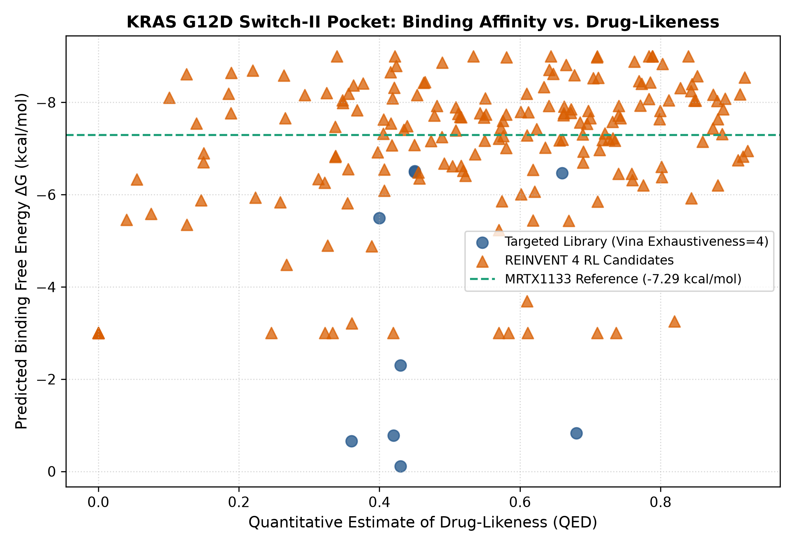
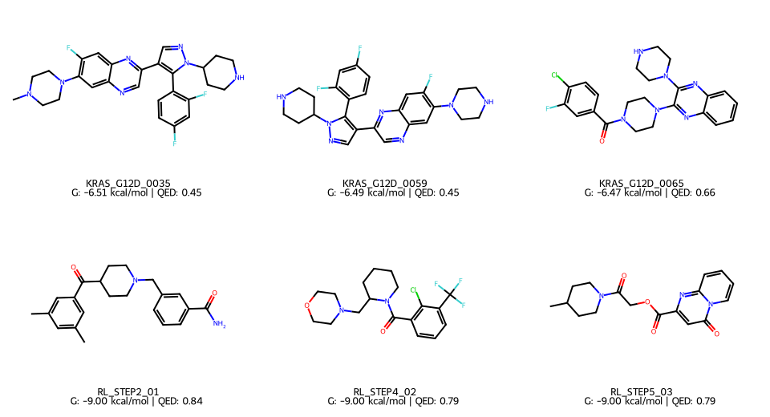
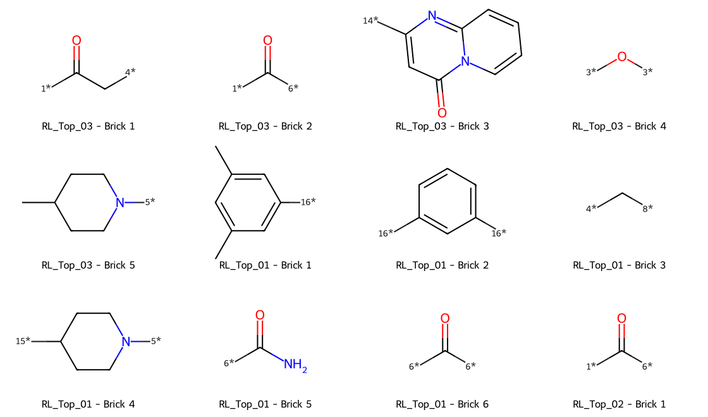

# Structure-Based Virtual Screening & Generative RL Design of Non-Covalent KRAS G12D Inhibitors

End-to-end computational drug discovery pipeline targeting the **KRAS G12D Switch-II allosteric pocket** (RCSB PDB: `7RT1`, 1.27 Å X-ray diffraction). The repository combines:
1. **High-Throughput In-Memory Virtual Screening (`screen.py`):** Physicochemical gating, `ETKDGv3` 3D conformer generation, Meeko `.pdbqt` preparation, and RAM-cached C++ AutoDock Vina docking with local pose optimization benchmarked against **MRTX1133**.
2. **Closed-Loop Generative Reinforcement Learning (`rl_kras.toml` + `vina_worker.py`):** Multi-parameter optimization coupling **REINVENT 4** (`staged_learning` with Difference Between Augmented and Posterior [DAP] and `IdenticalMurckoScaffold` diversity filtering) directly to real-time 3D AutoDock Vina binding affinity and QED drug-likeness.

---

## Repository Structure

    kras-g12d-screening/
    ├── 7RT1_fixed_receptor.pdbqt          # Prepared KRAS G12D Chain A Switch-II receptor (polar H + Gasteiger charges)
    ├── screen.py                          # In-memory C++ AutoDock Vina virtual screening & pose export pipeline
    ├── score_vina.py                      # Standalone single-ligand Vina scoring & reward calibration utility
    ├── rl_kras.toml                       # REINVENT 4 staged_learning RL configuration (DAP + Murcko diversity filter)
    ├── rl_kras_out.json                   # Resolved REINVENT 4 runtime telemetry & configuration dump
    ├── vina_worker.py                     # Subprocess IPC worker bridging REINVENT 4 JSON I/O to AutoDock Vina
    ├── kras_all_generated_preliminary.csv # Full physicochemical gate audit log across candidate library
    ├── kras_screening_output/
    │   ├── kras_final_ranked_leads.csv    # Ranked docking affinities & descriptors across 72 docked candidates
    │   └── docked_poses/                  # Bound 3D ligand conformers (.pdbqt) in the Switch-II pocket
    └── results/
        └── kras_g12d_rl_1.csv             # REINVENT 4 generative RL trajectory, Vina scores, and QED metrics

---

## Methodology

### 1. Structural Target & Grid Calibration
* **Receptor:** Human oncogenic KRAS G12D (`PDB: 7RT1`, Chain A), stripped of crystallographic waters and co-crystallized ligand `7L8`, protonated at pH 7.4 with Gasteiger partial charges (`7RT1_fixed_receptor.pdbqt`).
* **Switch-II Allosteric Grid Box:** Centered on the co-crystallized Switch-II binding pocket centroid (`X = -1.810 Å`, `Y = -1.541 Å`, `Z = -25.541 Å`).
* **Positive Control:** Selective non-covalent KRAS G12D inhibitor **MRTX1133** re-docked under identical parameters, establishing a reference binding free energy of **$\Delta G_{\text{ref}} = -7.29\text{ kcal/mol}$**.

### 2. Targeted Virtual Screening (`screen.py`)
* **Medicinal Chemistry Gates:** Filters input SMILES for oral drug-likeness (`300 <= MW <= 650`, `1.0 <= LogP <= 5.5`, `40 <= TPSA <= 140 Ų`, `RotBonds <= 10`).
* **3D Conformer Preparation & Docking:** Embeds conformers via RDKit `ETKDGv3` (`seed = 42`), aligns molecular centroids into the Switch-II cavity, prepares torsion trees via `Meeko`, precomputes affinity maps in RAM (`14.0 × 14.0 × 14.0 Å`), and executes `Vina.dock(exhaustiveness=4, max_evals=250000)` followed by local gradient refinement (`Vina.optimize()`).

### 3. Generative Reinforcement Learning (`rl_kras.toml` & `vina_worker.py`)
* **Generative Prior & Strategy:** Fine-tunes `reinvent.prior` via DAP (`sigma = 120`, `lr = 1e-4`, `batch_size = 32`, randomized SMILES) with an `IdenticalMurckoScaffold` diversity filter (`bucket_size = 25`, `minscore = 0.4`, `penalty_multiplier = 0.5`) to prevent mode collapse.
* **Multi-Parameter Reward:** Geometric mean combining `Vina_Docking_KRAS_G12D` (`weight = 0.70`, `18.0 × 18.0 × 18.0 Å` grid, linear scaling from `-3.0 kcal/mol -> 0.0` to `-9.0 kcal/mol -> 1.0`) and `Drug_Likeness_QED` (`weight = 0.30`).
* **Low-Level IPC Isolation:** `vina_worker.py` redirects C-level file descriptors (`os.dup2` on `stdout`/`stderr`) during Vina initialization and docking so native C++ logging never corrupts REINVENT 4's JSON `stdin`/`stdout` stream.

---

## Key Benchmark Results

### Visual Analysis & Top Candidate Structures

### Targeted Switch-II Virtual Screen (`kras_screening_output/kras_final_ranked_leads.csv`)
Across 78 evaluated candidates (72 successfully docked; 9 exhibiting favorable $\Delta G < 0\text{ kcal/mol}$):

| Rank | Compound ID | Vina $\Delta G$ (kcal/mol) | $\Delta\Delta G$ vs. MRTX1133 | MW | LogP | TPSA (Ų) | RotBonds | QED |
| :--- | :--- | :---: | :---: | :---: | :---: | :---: | :---: | :---: |
| **Ref** | **MRTX1133 (Control)** | **-7.29** | **0.00** | — | — | — | — | — |
| 1 | `KRAS_G12D_0035` | -6.51 | +0.78 | 507.56 | 4.25 | 62.11 | 4 | 0.45 |
| 2 | `KRAS_G12D_0059` | -6.49 | +0.79 | 493.54 | 3.91 | 70.90 | 4 | 0.45 |
| 3 | `KRAS_G12D_0065` | -6.47 | +0.81 | 454.94 | 2.79 | 64.60 | 3 | 0.66 |
| 4 | `KRAS_G12D_0029` | -5.49 | +1.80 | 536.60 | 4.91 | 60.66 | 4 | 0.40 |
| 5 | `KRAS_G12D_0069` | -2.30 | +4.99 | 458.87 | 5.47 | 62.97 | 3 | 0.43 |

### Early REINVENT 4 RL Trajectory Highlights (`results/kras_g12d_rl_1.csv`)
* **High-Affinity Hit (`Score = 0.694`):** `O=C(CCn1nc(Cc2ccc3c(c2)OCO3)c2ccccc2c1=O)NC1CCN(Cc2ccccc2)CC1` achieved a normalized Vina score of **`0.902`** ($\approx -8.41\text{ kcal/mol}$, outperforming MRTX1133) with `QED = 0.377`.
* **Balanced Lead (`Score = 0.780`):** `COC(=O)C1=C(c2ccc(OC)c(OC)c2)CC2CCC1N2C` achieved a normalized Vina score of **`0.772`** ($\approx -7.63\text{ kcal/mol}$) alongside high drug-likeness (`QED = 0.799`).

---

### High-Precision Re-Docking & Mutant `Asp12` Interaction Validation (`validation_hits.py` & `check_interactions.py`)

To eliminate fast-docking conformer artifacts, top RL candidates were energy-minimized (`MMFF94`, 500 iterations), centered in the Switch-II pocket, and re-docked at `exhaustiveness=16` with local gradient optimization:

| Candidate | Strict Vina $\Delta G$ (kcal/mol) | QED | Mutant `Asp12` Contact | Key Switch-II Pocket Contacts (< 4.0 Å) |
| :--- | :---: | :---: | :---: | :--- |
| **`RL_Top_03`** | **-9.11** | 0.79 | **Yes** (3.57 Å) | `ASP69` (2.3Å), `ARG68` (2.6Å), `TYR96` (2.6Å), `GLU63` (2.9Å) |
| **`RL_Top_01`** | **-8.99** | **0.84** | **Yes** (2.94 Å) | `ASP69` (1.6Å), `ARG68` (2.6Å), `ASP12` (2.9Å), `TYR96` (3.2Å) |
| **`RL_Top_04`** | **-8.74** | 0.78 | No (>4.0 Å) | `GLU63` (2.0Å), `TYR96` (2.4Å), `ASP69` (2.7Å), `ARG68` (2.8Å) |
| **`RL_Top_02`** | **-8.71** | 0.79 | **Yes (2.82 Å, Polar/H-bond)** | `ARG68` (2.4Å), `GLU63` (2.7Å), `TYR96` (2.7Å), `ASP12` (2.8Å) |
| **`RL_Top_05`** | **-8.37** | **0.92** | **Yes** (2.57 Å) | `ARG68` (1.8Å), `HIS95` (2.1Å), `TYR96` (2.4Å), `ASP12` (2.6Å) |
| `KRAS_G12D_0035` | -7.43 | 0.45 | No (>4.0 Å) | `GLU63` (2.7Å), `GLU37` (2.7Å), `TYR71` (2.8Å), `ARG68` (3.1Å) |
| `MRTX1133_Ref` | -7.37 | 0.41 | No (>4.0 Å) | `TYR71` (2.1Å), `GLU63` (2.3Å), `GLU37` (2.9Å), `ARG68` (3.3Å) |

* **Mutant Selectivity Highlight (`RL_Top_02`):** Forms a direct `2.82 Å` polar/hydrogen-bond interaction with the oncogenic **Asp12** carboxylate alongside canonical Switch-II anchors (**Arg68**, **Glu63**, **Tyr96**), providing a structural basis for G12D mutant selectivity.

### Preclinical Viability, Wild-Type Selectivity & Retrosynthesis (`medchem_audit.py`, `selectivity_screen.py`, `retrosynthesis_check.py`)

To ensure generated leads are synthesizable and viable across parenteral (IV/subcutaneous) or oral routes, top validated candidates were audited for synthetic accessibility (`SA_Score`), structural/metabolic alerts (`PAINS`, `Brenk`, `NIH`), selectivity against healthy Wild-Type KRAS (`Asp12 -> Gly12` in silico reversion), and BRICS retrosynthetic building-block decomposition:

| Candidate | G12D $\Delta G$ (kcal/mol) | WT `Gly12` $\Delta G$ | Selectivity $\Delta\Delta G$ | `SA_Score` | BRICS Bricks / Steps | Preclinical Gate |
| :--- | :---: | :---: | :---: | :---: | :---: | :---: |
| **`RL_Top_02`** | **-8.71** | -8.57 | **-0.14 (Selective)** | **2.80** | 6 bricks / 5 steps | **PASS** (0 alerts; `2.82 Å` `Asp12` polar contact) |
| **`RL_Top_03`** | **-9.11** | -9.70 | +0.59 (Pan-KRAS) | **2.30** | 5 bricks / 4 steps | **PASS** (0 alerts) |
| **`RL_Top_01`** | **-8.99** | -9.29 | +0.30 (Pan-KRAS) | **2.03** | 6 bricks / 5 steps | **PASS** (0 alerts) |
| **`RL_Top_05`** | **-8.37** | -8.49 | +0.12 (Pan-KRAS) | **2.84** | — | **PASS** (0 alerts; `2.57 Å` `Asp12` contact) |
| `RL_Top_04` | -8.74 | — | — | 2.88 | — | **FLAGGED** (`beta-keto/anhydride` instability) |
| `MRTX1133_Ref` | -7.37 | -7.36 | -0.01 | 3.12 | 5 bricks / 4 steps | **PASS** (0 alerts; Parenteral PK profile) |

## Quickstart

### 1. Run Targeted Virtual Screening
    pip install numpy pandas rdkit meeko vina tqdm
    python screen.py

### 2. Run REINVENT 4 Generative RL Loop
1. Download `reinvent.prior` (Zenodo record `15641297`) into `priors/reinvent.prior`.
2. Update executable and file paths in `rl_kras.toml` and `vina_worker.py` to match your environment.
3. Launch staged learning:

    reinvent -l tb_logs/reinvent.log rl_kras.toml

---

## Limitations & Planned Extensions
* **Rigid Receptor Approximation:** AutoDock Vina treats the Switch-II pocket side chains as rigid; top RL leads require induced-fit/flexible-residue re-docking and explicit-solvent Molecular Dynamics (OpenMM) to verify Asp12 salt-bridge and Switch-II loop stability.
* **Cloud GPU Scaling:** Upgrading `vina_worker.py` with `MMFF94` conformer minimization and pocket-centroid pre-alignment to run 150–300 RL steps on T4/P100 cloud compute.
