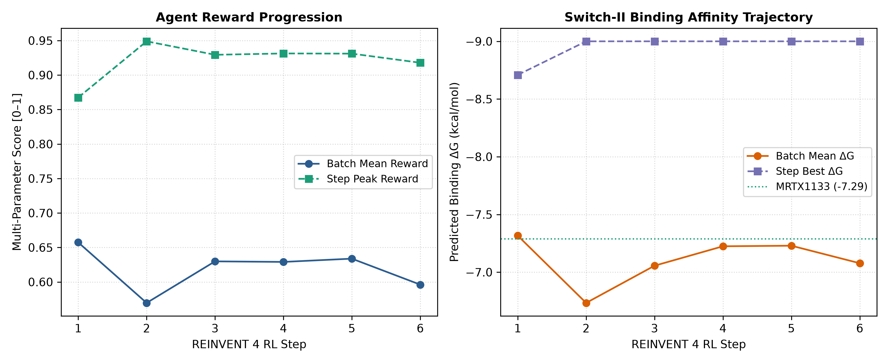

# Structure-Based Generative RL & Multi-Physics Validation of Non-Covalent KRAS G12D Inhibitors

[-1e3a8a)]()
[]()
[]()

End-to-end generative drug discovery and multi-physics auditing pipeline targeting the **KRAS G12D Switch-II allosteric pocket** and mutant **Asp12** carboxylate anchor.

---

## 1. Pipeline Architecture


---

## 2. Multi-Stage Validation Funnel & RL Optimization

| Multi-Stage Attrition Funnel | REINVENT 4 Policy Learning Trajectory |
| :---: | :---: |
|  |  |

---

## 3. Multi-Physics & Medicinal Chemistry Audit


---

## 4. Chemical Novelty Space & Top Validated Leads

| ECFP4 Chemical Space Map vs. Clinical Inhibitors | Top 8 MPO-Ranked Novel Leads |
| :---: | :---: |
|  |  |

---

## 5. Quickstart

```bash
# 1. Run exhaustive chemoinformatics, pH 7.4 protonation, strain & WT selectivity audit
python scripts/exhaustive_kras_benchmark.py \
  --input results/kras_g12d_balanced_1.csv \
  --receptor receptors/7RT1_fixed_receptor.pdbqt \
  --wt-receptor receptors/7RT1_wt_gly12.pdbqt \
  --top-dock 150 \
  --exhaustiveness 16 \
  --workers 4

# 2. Regenerate all 300-DPI figures in figures/
python scripts/generate_publication_figures.py
